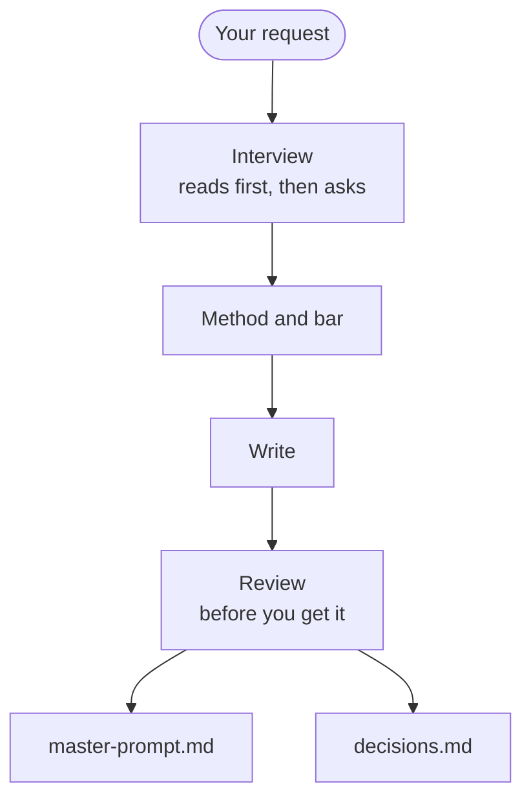

# briefwright — a plan writer for AI coding agents

**Describe the job in one sentence. briefwright asks what's missing, then writes the full plan your AI agent can follow on its own.**

For anyone, expert or not, who hands work to an AI coding agent such as Claude Code or Codex. The plan is a master prompt: one file that a new agent session follows from start to finish.

Install in one line for Claude Code, Codex and more: [Install](#install).

[](https://github.com/VibeCoding-1/briefwright/actions/workflows/ci.yml) [](https://github.com/VibeCoding-1/briefwright/releases) [](LICENSE) [](https://agentskills.io/specification)

![Three statements appear one after another, condensed from a real prompt the skill wrote, with a model answering its questions. One message in. Under it, the request: “…a landing page for my supplement brand that looks premium…” It asks what’s missing. A plan your agent can run alone. From that line an arrow points to a thumbnail of master-prompt.md, which lists some of its section headings in order, a gap marking each skipped stretch: Mission, Method, The bar, Stop rules and interrupt policy. All four turn green.](docs/media/demo.svg)

<sub>Condensed from a real prompt the skill wrote, with a model answering its questions. [The prompt and its decisions](examples/premium-landing-page/).</sub>

## Install

```sh
# Claude Code
claude plugin marketplace add VibeCoding-1/briefwright && claude plugin install briefwright@vibecoding-1

# Codex
codex plugin marketplace add VibeCoding-1/briefwright && codex plugin add briefwright@vibecoding-1

# Gemini CLI, Copilot, Cursor, OpenCode, Antigravity and more, through the skills CLI
npx skills add VibeCoding-1/briefwright
```

Tested on Claude Code, Codex, OpenCode, Antigravity and claude.ai (October 2026). Also installs on Gemini CLI, Copilot CLI, Cursor and the GitHub CLI; reports welcome. Every route, its status and [the one permission Claude Code may ask for](docs/install.md#the-one-permission-claude-code-may-ask-for) are in [docs/install.md](docs/install.md).

Then ask in your own words: "write me a master prompt to …", "prepare a prompt another session can run on its own". No command to learn: your agent starts briefwright when a request fits, as with any skill in the open Agent Skills format, a shared standard many AI agents read.

## Why briefwright

- **Made for runs nobody watches.** Tell it you will start the session and walk away: the plan then shows your agent how to keep going and pick up where it left off.
- **It asks before it guesses.** It reads your files first, asks only what it cannot find out, and leaves anything still unknown as a visible gap, never an invented value.
- **Every job gets a finish line.** The plan turns "done" into checks your agent runs, wherever checks fit, and its stop rules end the work on success or when progress stalls.
- **Checked before you get it.** A script checks every plan, and on larger jobs, where your agent can start them, fresh subagents (helper agents that have not seen your chat) read it cold.

## Before and after

**Before:** a whole request, from a real run of the skill with a model answering its questions.

> Hi, can you write me a prompt for Opus 5.5 to fix the prices page on my shop's website? The files are all in this folder. On my phone the price table runs off the right-hand side and you have to scroll sideways to see the prices. It must never scroll sideways on a phone. On the laptop it looks fine and I want it to stay like that. And please don't change any of the prices or the wording. I'll be sat at my desk while it works, so it can just ask me if it needs anything.

The skill read the site's files before asking anything and found a second cause the person had not mentioned. It said so, then asked three numbered questions: how the session would be launched, how the table should look on a phone, and which screen widths count.

<details>
<summary>After: the person's reply, and two passages of the prompt, quoted exactly</summary>

The person's whole reply:

> Oh, I hadn't noticed the opening hours box. Fix that too then, nothing on that page should go sideways. The rest sounds right.
>
> 1. Claude Code, in the terminal on this same computer. Opus 5.5 for everything. I don't know about effort, so whatever you recommend.
> 2. (b) is fine. Labels are fine as long as the prices and descriptions themselves stay word for word.
> 3. I don't know the sizes. Mine's a few years old and customers have all sorts, so (a) is fine. It looks fine on the laptop, keep it exactly like that.

Two passages of the prompt, quoted exactly as the example now reads, trimmed to the current skill:

> **The causes**, from the CSS (your first check run confirms them):
> 1. `table.prices { min-width: 680px; }` at `css/style.css` line 60: any screen under about 712px scrolls.
> 2. `.hours { width: 440px; }` at line 90, 476px with padding and border: any screen under about 500px scrolls even once the table is fixed.

> **Ruled out:**
> - No scrolling box around the table (`overflow-x: auto` or `scroll`): still sideways scrolling. Make the content fit.
> - No `overflow: hidden`, `overflow-x: hidden` or `clip` on any container: it would hide prices.
> - No `zoom`, `transform: scale` or viewport `<meta>` change: the text would shrink.

</details>

The rest of the prompt turns each of the person's three demands into a check the session carries out. Nothing may reach past the edge of the screen at any width from 320 to 1920 px. The laptop view must match, pixel for pixel, a copy taken before the first edit. The words and prices must not change. Before its first edit, the session must see the sideways-scroll checks fail on the unfixed page, which proves they can catch the problem. It is done only when every check passes and the person has approved the look on a phone. [The whole prompt and its decisions](examples/prices-page-on-a-phone/).

## How it works

The skill never does the task, and never runs the prompt in its own session: it writes the prompt for the session that will, and tells you how to start it.



- **The quick lane.** A small task that touches nothing irreversible takes one round of questions, a short prompt and no subagents.
- **Harness guides.** The [Claude Code](skills/briefwright/references/harness-claude-code.md), [Codex](skills/briefwright/references/harness-codex.md) and [generic](skills/briefwright/references/harness-generic.md) guides say how a run is launched and how each seat gets its model. Every vendor fact in them carries its source and the date it was read; what could not be established is marked open, never guessed. The rest of the skill names no model and no harness tool.
- **Guidance packs.** A pack adds wording written for one model to the prompts that run on it when you name that model. None ships, and a pack never changes a rule of the skill.

<details>
<summary>The five steps in detail</summary>

1. **Frame.** It reads what you gave it and the folder you work in, then settles eight facts, most of them found rather than asked: the working folder, greenfield or existing, the size (quick, standard or deep), whether anyone will watch the run, the harness, what the harness can do, whether the work fits the run, and how long the run may take.
2. **Understand.** It explores before it asks, checks every claim about a tool or an API before building on it, then asks in rounds, each question with why it matters and a recommended answer (in Claude Code, with you answering, in its question picker; elsewhere as numbered text), until nothing that changes the work is assumed. Every answer, and your own words, go into `decisions.md`.
3. **Design the method.** Verification first; then the goal and the bar that says when it is done, the route, the shape (one pass, phases, a builder and critic loop…), whether a fresh reviewer earns its place, who leads, and stop rules that end on success or on a plateau, never on a count.
4. **Write.** One Markdown file, `prompts/<task-id>/master-prompt.md`, with `decisions.md` beside it: the decisions and their sources, the open questions, the launch command.
5. **Review.** A linter (`scripts/lint_prompt.py`) checks the prompt against its decisions. On a standard task a fresh subagent reads the prompt cold and reviews it; on a deep or unattended one, two fresh subagents do, neither seeing the other. Where the harness cannot start a subagent, the skill does their work itself and says the read was not cold.

</details>

## Examples

- **[The prices page on a phone](examples/prices-page-on-a-phone/).** A quick fix in one attended session: a second cause found before any question, and each of the person's three demands turned into a check.
- **[A "premium" landing page, for an overnight cloud run](examples/premium-landing-page/).** In Spanish: a two-sentence request becomes an unattended run with critics, scripted checks and a time box.
- **[What a real run taught](examples/what-a-real-run-taught.md).** Seven lessons of a long unattended run, traced to the rules they became.

## How it is tested

Every push and pull request runs the unit tests, the skill's self-check and the leak scanner in CI, and validates the skill and its plugin files against their published formats. Each install route's status, with the version and date of each test, is in [docs/install.md](docs/install.md#every-route-with-its-status).

## FAQ

- **Which agents does it work with?** Any agent that reads the open Agent Skills format. Claude Code and Codex have guides of their own; Gemini CLI, Copilot, Cursor, OpenCode and the rest use the generic one. It is tested on Claude Code, Codex, OpenCode, Antigravity and claude.ai, and also installs on Gemini CLI, Copilot CLI, Cursor and the GitHub CLI ([docs/install.md](docs/install.md) gives each route's status).
- **How is it different from spec-kit, BMAD, OpenSpec, Task Master or superpowers?** Those guide your agent while it works: Spec Kit and OpenSpec turn what you want into specs, a plan and tasks; the BMad Method is an agile method from idea to working software; Taskmaster manages tasks drawn from your requirements; Superpowers is a development method built from skills that fire on their own. briefwright does one thing: it writes one master prompt, with its checks and stop rules, for a fresh session to run alone. It has not been tried alongside any of them.
- **Why not just ask my agent to make a plan first?** briefwright reads your files and asks until nothing that changes the work is assumed, then picks a method that fits the task. It writes down what "done" means as checks your agent runs, wherever checks fit, and when to stop. Before you get the plan, a script checks it, and on larger jobs, where your agent can start them, fresh subagents read it cold.
- **Does it pick a model for me?** No. It asks which harness the run will use and names no model itself. Each prompt with subagents tells the agents to give each one the model its work needs: the strongest available for planning, hard building and review, a faster one for searches and simple checks. If you name a model, the run uses that one, set at launch.
- **Does it send my data anywhere?** The skill runs inside your agent and sends nothing itself: it is instructions plus a script that makes no network call. If you install with the `skills` CLI, that CLI counts installs anonymously unless `DISABLE_TELEMETRY=1` or `DO_NOT_TRACK=1` is set.
- **Is it worth it for a small task?** A small task that touches nothing irreversible takes the quick lane: one round of questions, a short prompt, no subagents. To have the work done now, or for a one-line prompt, ask your agent directly.
- **Can the run go unattended?** Yes. Say you will start it and leave it, and the prompt is written for a run nobody watches: one that decides alone, rides out usage limits and resumes from its own files. [The landing page](examples/premium-landing-page/) is such a prompt.
- **What do I get?** Two files in `prompts/<task-id>/`: `master-prompt.md`, which a fresh session runs, and `decisions.md`, with every decision and its source, your own words, the open questions and the launch command. You start that session; the skill never runs the prompt itself.
- **Can I adapt it?** Yes: a guidance pack adds wording for one model, and a guide adds a harness. See [Adapting it](#adapting-it).

## Adapting it

- **Wording for a model.** Copy [`packs/TEMPLATE.md`](skills/briefwright/packs/TEMPLATE.md) to `packs/<pack-id>.md`, list the model ids it matches, and give every line its source. [`packs/README.md`](skills/briefwright/packs/README.md) holds the format and its one rule. Paste no published text unless its licence allows it.
- **A guide for another harness.** Copy the shape of [`harness-generic.md`](skills/briefwright/references/harness-generic.md): its five headings and its blocks, with every fact sourced. [CONTRIBUTING.md](CONTRIBUTING.md) says what else changes with it.

## Contributing

Issues and pull requests are welcome; [CONTRIBUTING.md](CONTRIBUTING.md) gives the checks to run and the rules a change keeps.

## Licence

Apache-2.0: see [LICENSE](LICENSE). [NOTICE](NOTICE) credits the projects whose ideas the skill adopted; no text was copied from them. To report a vulnerability, see [SECURITY.md](SECURITY.md).

If it saves you time, a star helps others find it; ideas are welcome in [Discussions](https://github.com/VibeCoding-1/briefwright/discussions).
